# Hai, saya Ahnaf 👋

**Software Engineer & Content Writer** dari Malang, Jawa Timur, Indonesia.
Lulusan jurusan RPL (Rekayasa Perangkat Lunak) yang suka membangun sistem informasi dari nol, mulai dari database, backend, sampai tampilan.

## Yang sedang saya kerjakan

- 🏫 **SIAS**: sistem absensi siswa berbasis QR Code + GPS
- 🏘️ **SiWarga**: sistem informasi warga RT (Laravel + Flutter)
- 🏢 **SIVERGA**: sistem absensi dan penggajian staf perumahan

## Tech stack

## Selain coding

- ✍️ Content writing, press release, dan SEO (E-E-A-T)
- 🌐 Pengelolaan domain dan website dari nol sampai maintenance

## Statistik GitHub

## Hubungi saya

- 🔗 Portofolio: [ahnafrm-src.github.io/portofolio](https://ahnafrm-src.github.io/portofolio/)
- 💻 GitHub: [@ahnafrm-src](https://github.com/ahnafrm-src)
